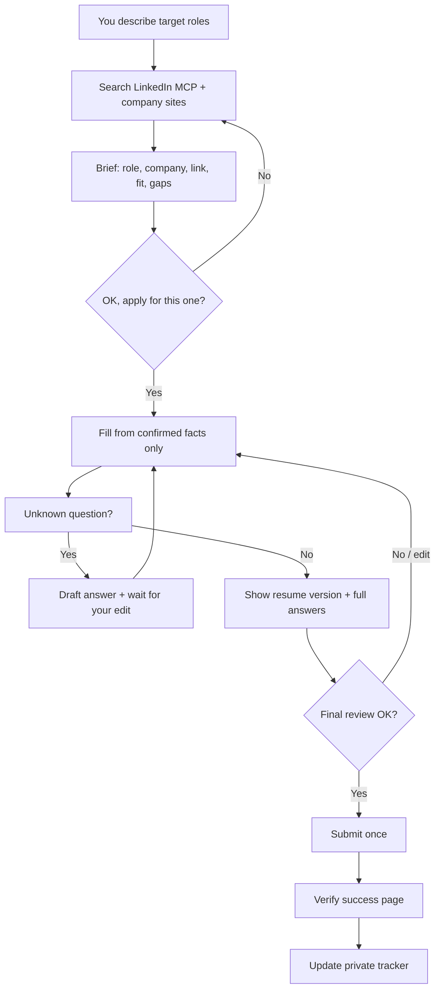

# JobFather

A Grok Bot setup for job search and applications with hard approval gates. It finds roles, shows you a short brief, waits for your OK on that specific job, drafts every answer for you to edit, then shows the completed form and resume for a final review before it submits.

Built for [Grok Bot](https://cursor.com). LinkedIn discovery uses [stickerdaniel/linkedin-mcp-server](https://github.com/stickerdaniel/linkedin-mcp-server) (Apache-2.0) in read-only mode. Applications and profile edits go through the browser, never through MCP write tools.

## How it works



Two gates, every time:

1. **Per-role OK.** Preparation starts only after you say yes to that specific posting.
2. **Final review.** Submission happens only after you confirm the exact answers and resume version.

## Features

- Short briefs with original posting URL and fit grounded in your resume facts
- Approval-gated apply flow (no blanket or batch auto-apply)
- Draft-before-asking on every question; you edit, then it uses your reply
- Confirmed-answer bank with provenance
- Private application tracker (status, resume version, confirmation evidence)
- Resume create / edit / tailor, with version history and PDF on request
- LinkedIn profile upkeep with exact-diff approval before saving
- Posting checks against the original employer page where possible
- Vault-first sign-in for normal browser logins

## What's in this repo

| Path | What it is |
|------|------------|
| `persona/JOBFATHER.md` | Full bot persona / instructions to paste into a Grok Bot |
| `mcp/connector.example.json` | Example local MCP connector config (placeholder paths) |
| `mcp/CONNECTOR_INSTRUCTIONS.md` | Read-only connector instructions |
| `examples/profile.example.json` | Fictional career-fact schema (fill privately; never commit real data) |
| `LICENSE` | MIT |

Nothing here is a live resume, answer bank, tracker, credential, or session.

## Setup

### 1. Create the Grok Bot

1. Create a new Grok Bot named JobFather (or your preferred name).
2. Paste `persona/JOBFATHER.md` into the bot description / persona field.
3. Keep the hard rules at the bottom intact.

### 2. Install the LinkedIn MCP

Requires Python 3.11+ and a writable directory for the browser profile.

```bash
python -m venv .venv
source .venv/bin/activate
pip install 'mcp-server-linkedin==4.29.0'
mkdir -p ./linkedin-mcp-profile
```

Copy `mcp/connector.example.json`, replace the two `/path/to/...` placeholders with your venv binary and profile directory, then add the connector to the bot (stdio transport). Paste `mcp/CONNECTOR_INSTRUCTIONS.md` into the connector instruction field.

Required flags and env (do not omit):

- `--no-auto-import`
- `AUTO_IMPORT_FROM_BROWSER=false`

Do not use `--import-from-browser`. Do not copy cookies between browsers.

### 3. One-time LinkedIn sign-in (MCP window)

The connector opens its own **Chrome for Testing** window. Vault autofill cannot reach that window.

1. Start or wake the connector so the Testing window appears.
2. Sign in to LinkedIn yourself in that smaller window (not your regular Chrome).
3. Wait about 30 seconds, then confirm with `get_session_status` (`cookies` true).
4. After that, the profile directory reuses the session.

All other sign-ins (regular browser, employer sites) still use vault credentials first. If a vault fill fails, the bot asks you for input through the secure form. It never asks for passwords in chat.

### 4. Private onboarding

Send your resume to JobFather directly. Tell it target roles, location or remote preferences, seniority, salary expectations, work authorization constraints, and dealbreakers. It builds a private fact record and answer bank. Those stay off this repository.

### 5. First supervised apply

Treat the first live application as a dry run of the two approval gates. Confirm both stops work before you rely on the flow.

## Safety rules

- Never apply without your approval on that specific role, then again on the final answers.
- If the bot is unsure, it stops and asks. It does not invent qualifications, dates, metrics, or answers.
- Credentials stay in the vault. They never go in chat, memory, files, or GitHub.
- No cookie extraction or import.
- Optional demographic / EEO fields are never chosen by the bot.
- This public repo must never contain resumes, personal data, answers, credentials, session state, screenshots, or application records.

## Limitations

- The LinkedIn MCP is for discovery and form inspection only. It does not submit applications.
- Easy Apply and company ATS pages differ; some forms need more back-and-forth.
- LinkedIn may challenge logins (2FA, captcha, device approval). Those need you.
- Authenticated search depends on a valid MCP browser session. If it expires, sign in again in the Testing window.
- Interview prep is optional future work, not part of this setup.

## Credits

- LinkedIn MCP: [stickerdaniel/linkedin-mcp-server](https://github.com/stickerdaniel/linkedin-mcp-server) (`mcp-server-linkedin` on PyPI), Apache-2.0
- Runtime: Grok Bot / Cursor

## License

MIT. See [LICENSE](LICENSE). The LinkedIn MCP dependency remains Apache-2.0 under its own terms.
