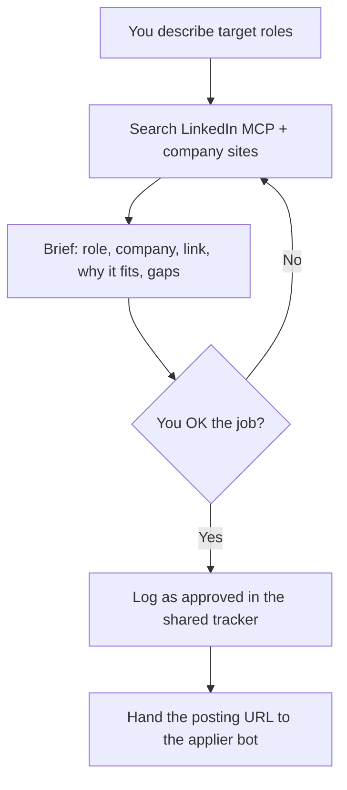

# JobFather

A Grok Bot setup for job search. It finds roles that match your criteria, sends you a short brief for each one (the offer, the link, and why it fits), and keeps your resume and LinkedIn profile truthful. It does not apply, fill forms, or submit. When you OK a job, it logs the job as approved in a shared private tracker and hands the posting URL to a separate applier bot.

Companion: [jobapplicatoooor](https://github.com/simo255/jobapplicatoooor)

Built for [Grok Bot](https://cursor.com). LinkedIn discovery uses [stickerdaniel/linkedin-mcp-server](https://github.com/stickerdaniel/linkedin-mcp-server) (Apache-2.0) in read-only mode. Profile edits go through the browser, never through MCP write tools.

**[Add JobFather to Grok Bot → public template](https://x.ai/bot/oSQv1RZTLDUF9Os_CzkQX)**

## How it works



JobFather stops at the brief and the handoff. It never fills a form or submits an application. It never hands over a job you have not approved.

## Features

- Short briefs with original posting URL and fit grounded in your resume facts
- Search across LinkedIn (read-only MCP) and company career pages
- Posting checks against the original employer page where possible
- Direct handoff: an approved job is logged in the shared tracker and sent to the applier bot
- Shared private folder for the official resume, confirmed answers, and the application tracker (never committed)
- Resume create / edit / tailor, with version history and PDF on request
- LinkedIn profile upkeep with exact-diff approval before saving
- Vault-first sign-in for normal browser logins

## What's in this repo

| Path | What it is |
|------|------------|
| `persona/JOBFATHER.md` | Full bot persona / instructions to paste into a Grok Bot |
| `skills/jobfather-workflow/SKILL.md` | Scout-only workflow skill |
| `skills/jobfather-getting-started/SKILL.md` | First-chat onboarding skill |
| `mcp/connector.example.json` | Example local MCP connector config (placeholder paths) |
| `mcp/CONNECTOR_INSTRUCTIONS.md` | Read-only connector instructions |
| `examples/profile.example.json` | Fictional career-fact schema (fill privately; never commit real data) |
| `examples/answers.example.md` | Fictional answers template for the shared private folder |
| `examples/tracker.csv` | Empty tracker header for the shared private folder |
| `examples/shared-folder-README.md` | README template for the shared private folder |
| `LICENSE` | MIT |

Nothing here is a live resume, fact record, tracker, credential, or session.

## Shared private folder

Both JobFather and [jobapplicatoooor](https://github.com/simo255/jobapplicatoooor) read and write a private folder that is **not** part of this repository. Pick a path both bots can access, for example `~/job-private/`, and record that path in each bot's private memory.

Suggested layout (see `examples/shared-folder-README.md`):

- Official resume: a PDF plus its HTML source. The applier uploads this file, never the resume stored inside Simplify.
- `answers.md`: owner-confirmed facts and answers only. Pending items stay blank. Start from `examples/answers.example.md`.
- `tracker.csv`: every job briefed, approved, or submitted. Header:

  ```
  date_et,company,role,posting_url,job_id,status,by_bot,resume_file,confirmation
  ```

  Start from `examples/tracker.csv`.

When you OK a job, JobFather appends a row with status `approved` and messages the applier bot with the posting URL. The applier checks the tracker before every submission so the same job is not applied to twice.

Keep this folder private. Never commit it, and never put real answers or a resume in this public repo.

## Setup

### 1. Create the Grok Bot

Fastest: open the [JobFather template](https://x.ai/bot/oSQv1RZTLDUF9Os_CzkQX) and add it. It comes with the persona and a first-run setup guide.

Manual alternative:

1. Create a new Grok Bot named JobFather (or your preferred name).
2. Paste `persona/JOBFATHER.md` into the bot description / persona field.
3. Copy `skills/jobfather-workflow/SKILL.md` and `skills/jobfather-getting-started/SKILL.md` into the bot's skills.
4. Keep the hard rules at the bottom of the persona intact.

### 2. Install the LinkedIn MCP

Requires Python 3.11+ and a writable directory for the browser profile.

```bash
python -m venv .venv
source .venv/bin/activate
pip install 'mcp-server-linkedin==4.29.0'
mkdir -p ./linkedin-mcp-profile
```

Copy `mcp/connector.example.json`, replace the two `/path/to/...` placeholders with your venv binary and profile directory, then add the connector to the bot (stdio transport). Paste `mcp/CONNECTOR_INSTRUCTIONS.md` into the connector instruction field.

Required flags and env (do not omit):

- `--no-auto-import`
- `AUTO_IMPORT_FROM_BROWSER=false`

Do not use `--import-from-browser`. Do not copy cookies between browsers.

### 3. One-time LinkedIn sign-in (MCP window)

The connector opens its own **Chrome for Testing** window. Vault autofill cannot reach that window.

1. Start or wake the connector so the Testing window appears.
2. Sign in to LinkedIn yourself in that smaller window (not your regular Chrome).
3. Wait about 30 seconds, then confirm with `get_session_status` (`cookies` true).
4. After that, the profile directory reuses the session.

All other sign-ins (regular browser, career-page search) still use vault credentials first. If a vault fill fails, the bot asks you for input through the secure form. It never asks for passwords in chat.

### 4. Private onboarding

Send your resume to JobFather directly. Tell it target roles, location or remote preferences, seniority, salary expectations, work authorization constraints, and dealbreakers. Point it at the shared private folder (or let it help you create one) so confirmed facts and the tracker live there. Those stay off this repository.

Pair it with [jobapplicatoooor](https://github.com/simo255/jobapplicatoooor), or another applier bot, so approved jobs can be handed over directly.

## Safety rules

- JobFather does not apply, fill forms, or submit. Applications are handled by a separate applier bot.
- It never hands the applier a job you have not approved.
- If the bot is unsure, it stops and asks. It does not invent qualifications, dates, metrics, or answers.
- Credentials stay in the vault. They never go in chat, memory, files, or GitHub.
- No cookie extraction or import.
- This public repo must never contain resumes, personal data, answers, credentials, session state, screenshots, or application records.

## Limitations

- The LinkedIn MCP is for discovery only. JobFather does not apply or submit.
- Application forms, including Easy Apply and company ATS pages, are out of scope; a separate applier bot handles them.
- LinkedIn may challenge logins (2FA, captcha, device approval). Those need you.
- Authenticated search depends on a valid MCP browser session. If it expires, sign in again in the Testing window.
- Interview prep is optional future work, not part of this setup.

## Credits

- LinkedIn MCP: [stickerdaniel/linkedin-mcp-server](https://github.com/stickerdaniel/linkedin-mcp-server) (`mcp-server-linkedin` on PyPI), Apache-2.0
- Companion applier: [jobapplicatoooor](https://github.com/simo255/jobapplicatoooor)
- Runtime: Grok Bot / Cursor

## License

MIT. See [LICENSE](LICENSE). The LinkedIn MCP dependency remains Apache-2.0 under its own terms.
